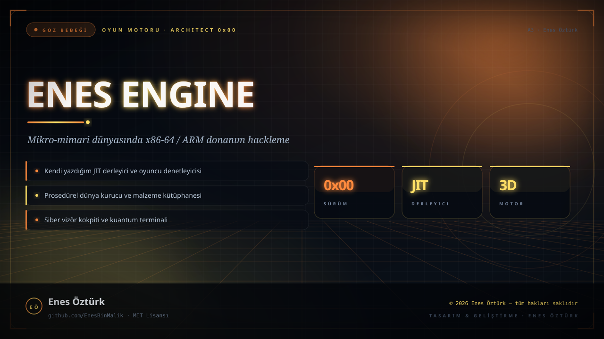
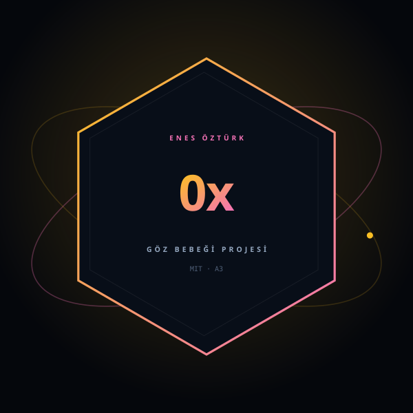

# ENES ENGINE: ARCHITECT 0x00



<p align="center"></p>

<p align="center"><b>GÖZ BEBEĞİ PROJESİ</b> · OYUN MOTORU · MİKRO-MİMARİ</p>

---

Mikro-mimari dünyasında x86-64 / ARM donanım hackleme: kendi motorum, kendi JIT derleyicim, kendi dünyam.

## Öne çıkanlar

- **JIT derleyici** — `src/engine/JitCompiler.ts` ile anlık kod üretimi
- **Dünya kurucu** — `WorldBuilder.ts` ile prosedürel mimari
- **Oyuncu denetleyicisi** — `PlayerController.ts` ile fizik tabanlı hareket
- **Malzeme kütüphanesi** — `Materials.ts` ile yüzey ve ışık
- **Donanım kokpiti** — `HardwareCockpit` ile kayıt izleme
- **Kuantum terminal** — `QuantumTerminal` ile komut arayüzü

## Teknoloji

React · TypeScript · Three.js · Vite · Motion · Tailwind CSS

## Kurulum ve çalıştırma

```bash
npm install
npm run dev        # http://localhost:3000
```

| Komut | Ne yapar |
| --- | --- |
| `npm install` | bağımlılıkları kurar |
| `npm run dev` | geliştirme sunucusunu açar |
| `npm run build` | üretim derlemesi üretir |
| `npm run lint` | tip denetimi (`tsc --noEmit`) |

## Proje yapısı

```
enes-engine_-architect-0x00/
├── index.html
├── package.json
├── vite.config.ts
├── docs/
│   ├── kapak.svg        # sinematik kapak
│   └── rozet.svg        # premium imza rozeti
└── src/
```

## Lisans ve telif

Bu proje **MIT Lisansı** ile yayınlanmıştır.

> © 2026 **Enes Öztürk** — tüm hakları saklıdır.
> Tasarım, kod ve görseller Enes Öztürk'e aittir. İzinsiz ticari kullanım yapılamaz.

[MIT Lisansı metni →](LICENSE)

---

<div align="center"><sub>
<a href="https://github.com/EnesBinMalik">github.com/EnesBinMalik</a> · 
imzalı bir <b>Enes Öztürk</b> projesi
</sub></div>
